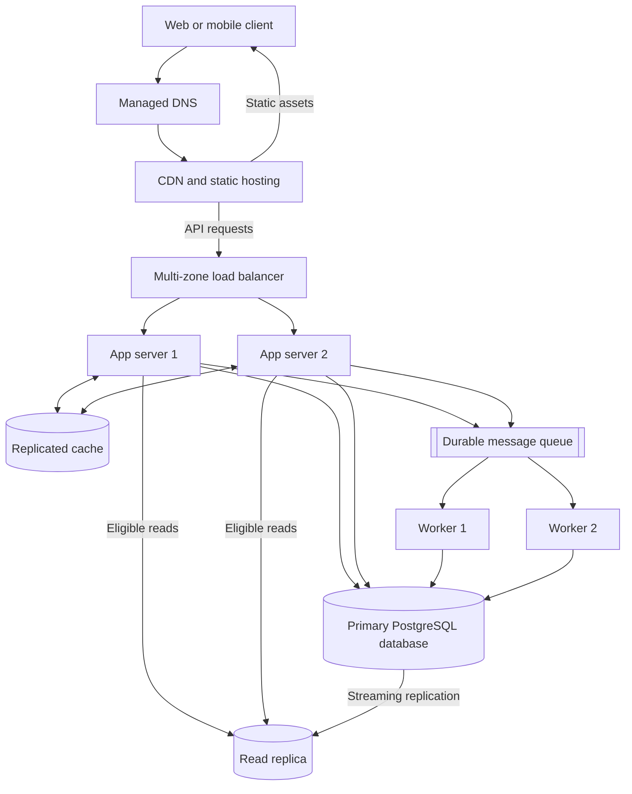

# QuickNotes System Architecture

## Scope and assumptions

This design supports one million registered users while keeping the first
version operationally straightforward. It assumes 20% of registered users are
active on a typical day and that traffic at the busiest time is ten times the
daily average. The API is deployed across at least two availability zones in
one region, with encrypted backups copied to a second region for disaster
recovery.

## Functional requirements

- Users can register, sign in, and sign out securely.
- Authenticated users can create, read, update, and delete their own notes.
- Users can create tags, attach them to notes, remove them, and filter notes by
  tag.
- The API supports pagination and returns notes in a stable order.
- Users cannot access notes or tags owned by another account.
- Background jobs can send notifications, write audit events, or perform other
  work that does not need to delay an API response.

## Non-functional requirements

- **Availability:** Target 99.9% monthly availability for the API.
- **Latency:** Target a p95 latency below 300 ms for note reads and below 500 ms
  for note writes under normal load.
- **Durability:** A successful write must survive an application-server failure;
  database backups and point-in-time recovery protect against larger failures.
- **Security:** Use TLS in transit, encryption at rest, salted password hashes,
  short-lived access tokens, authorization on every resource, and rate limits.
- **Scalability:** Stateless application servers and workers scale horizontally
  as traffic grows.
- **Consistency:** A user receives strongly consistent confirmation for note
  writes; cache entries and read replicas may be briefly stale.
- **Observability:** Centralized logs, metrics, traces, alerts, and request IDs
  make failures diagnosable.
- **Accessibility and maintainability:** APIs are versioned and documented, and
  the web client follows accessible HTML and interaction patterns.

## Load and storage estimate

### Workload assumptions

- 1,000,000 registered users.
- 20% daily active users (DAU) = 200,000 active users per day.
- Each active user performs 20 reads per day.
- Each active user performs 4 writes per day: about 3 note creations and 1
  update or deletion.
- Peak traffic is 10 times the daily average.
- A stored note consumes about 2 KB for its title, body, timestamps, ownership,
  and tag relationships before database indexes and storage overhead.

### Requests per second

```text
Reads per day       = 200,000 × 20 = 4,000,000
Average read rate   = 4,000,000 ÷ 86,400 ≈ 46 reads/second
Peak read rate      = 46 × 10 ≈ 460 reads/second

Writes per day      = 200,000 × 4 = 800,000
Average write rate  = 800,000 ÷ 86,400 ≈ 9 writes/second
Peak write rate     = 9 × 10 ≈ 90 writes/second
```

The initial system should therefore be tested beyond 460 reads/second and 90
writes/second. A 2× safety margin gives capacity targets of roughly 1,000
reads/second and 200 writes/second.

### Storage per year

```text
New notes per day       = 200,000 × 3 = 600,000
Logical note data/year  = 600,000 × 2 KB × 365 ≈ 438 GB
With 50% DB overhead    = 438 GB × 1.5 ≈ 657 GB/year
Primary plus one replica = 657 GB × 2 ≈ 1.3 TB/year
```

The working estimate is therefore **about 657 GB of new database storage per
year**, or **about 1.3 TB of physical storage per year** when one read replica
is included. Encrypted backups, transaction logs, and temporary capacity should
be budgeted separately. Retention policies and compression can reduce long-term
growth.

## Architecture diagram



The CDN serves public static files but does not cache private note responses.
Arrows from the CDN to the load balancer represent dynamic `/api` traffic
forwarded to the origin.

## Component responsibilities

- **Client:** Presents the user interface, validates basic input, and calls the
  HTTPS API.
- **Managed DNS:** Resolves the service domain and supports health-aware routing
  during infrastructure failures.
- **CDN and static hosting:** Delivers HTML, CSS, and JavaScript close to users,
  reducing latency and load on application servers.
- **Load balancer:** Performs health checks, terminates TLS, and distributes API
  requests across healthy application servers.
- **Application servers:** Authenticate requests, enforce ownership and
  validation, execute business logic, and remain stateless so replicas can be
  added or replaced easily.
- **Replicated cache:** Stores short-lived, frequently read data and rate-limit
  counters to reduce database work without becoming the source of truth.
- **Primary database:** Provides durable transactional storage and the
  authoritative version of users, notes, tags, and their relationships.
- **Read replica:** Serves read traffic that can tolerate slight replication lag
  and provides a promotion candidate if the primary fails.
- **Durable message queue:** Buffers asynchronous jobs so slow background work
  does not increase request latency and temporary worker failures do not lose
  jobs.
- **Workers:** Consume queued jobs with retry and idempotency controls, allowing
  background processing to scale independently of API traffic.

## Request flow: `GET /notes`

1. The client resolves the API hostname through DNS and sends an HTTPS request.
2. The CDN forwards the private API request to the load balancer without caching
   its response.
3. The load balancer selects a healthy application server.
4. The application server validates the access token, user identity, pagination
   parameters, and rate limit.
5. The server looks for a user-scoped cached result such as
   `notes:{userId}:{cursor}:{tag}`.
6. On a cache hit, the server returns the cached notes. On a miss, it queries the
   read replica; a request that requires read-after-write consistency uses the
   primary instead.
7. The server stores the result in the cache with a short time-to-live and
   returns `200 OK` with notes and pagination metadata.
8. Metrics, traces, and structured request logs are emitted without recording
   private note bodies.

## Request flow: `POST /notes`

1. The client sends the title and optional body as JSON over HTTPS.
2. DNS, the CDN, and the load balancer route the request to a healthy application
   server.
3. The application server authenticates the user, checks the rate limit, and
   validates that the trimmed title is present and no longer than 100
   characters.
4. The server inserts the note into the primary database in a transaction.
5. After the transaction commits, the server invalidates cached note lists for
   that user. Cache invalidation is safe to retry.
6. The server publishes any non-critical follow-up job to the durable queue.
   Publishing uses an outbox or equivalent retry mechanism so a committed event
   is not silently lost.
7. The server returns `201 Created`, the new note, and its `Location` header.
8. A worker later consumes the queued job, performs its idempotent background
   action, and acknowledges the message; failed jobs are retried and eventually
   sent to a dead-letter queue.

## Trade-offs

### SQL database versus horizontal write scaling

PostgreSQL provides transactions, foreign keys, and flexible joins, which fit
the relational data model and simplify correctness. A single write primary is
less horizontally scalable than a partitioned NoSQL store. At the estimated
peak of about 90 writes/second, a properly sized PostgreSQL primary has ample
capacity; read replicas, indexing, and later user-based partitioning postpone
the complexity of sharding.

### Cache speed versus freshness

Caching lowers read latency and database load, but cached lists can briefly show
old data. QuickNotes uses short TTLs plus invalidation after successful writes.
Requests that must immediately observe a write can bypass the cache and read
from the primary.

### Synchronous simplicity versus asynchronous resilience

Performing every side effect before responding would be simple and immediately
consistent, but slow dependencies would increase latency and failure rates. A
queue keeps non-critical work asynchronous and retryable at the cost of
eventual consistency and added operational components. Core note persistence
remains synchronous.

## Avoiding single points of failure

- DNS and the load balancer use managed, multi-zone services rather than a
  single host.
- At least two stateless application servers run in separate availability zones;
  health checks remove an unhealthy instance and autoscaling replaces it.
- The cache uses replication and automatic failover. If it is unavailable, the
  application can fall back to the database with stricter rate limits.
- PostgreSQL has a continuously replicated standby/read replica with automated
  promotion, point-in-time recovery, and tested encrypted backups in another
  region.
- The queue stores replicated messages, and at least two workers consume jobs;
  retries and a dead-letter queue isolate persistent failures.
- Deployments use rolling or blue-green replacement so a release does not stop
  every application server simultaneously.

The read replica reduces database risk but does not by itself provide complete
disaster recovery. Regular restore tests, cross-region backups, runbooks, and
monitored recovery-time and recovery-point objectives are also required.
